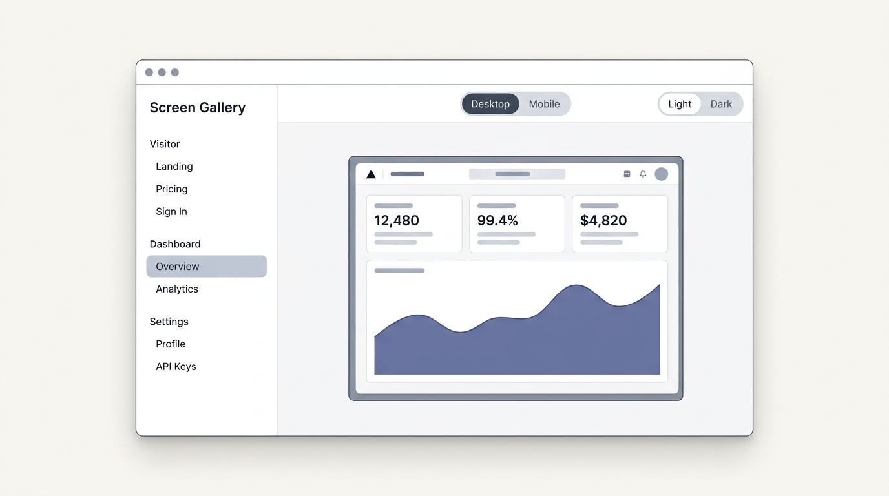

# Screen Gallery

> Zero-config, zero-CSS-dependency, full-page dev screen gallery for Vite + React apps and AI coding agents.



**Screen Gallery** is a lightweight, dev-only alternative to Storybook built for **full application routes, isolated components, and real user states** (authenticated, empty, loading, error, offline) — without touching your production bundle, starting a backend, or leaking state into your normal dev `localStorage`.

---

## Why Screen Gallery?

- **Zero CSS dependencies:** The gallery shell uses self-contained scoped CSS (no Tailwind or UI library required). It never breaks even if your app uses CSS Modules, styled-components, or its stylesheet fails to load.
- **Full routes + isolated components:** Mounts your real `<App />` inside an `<iframe>` at any route, or mounts individual components via `component: () => ...`.
- **True mobile breakpoints:** Toggle between **Desktop** and **Mobile (`372×772`)** inside a real iframe.
- **Zero backend required:** Intercepts `/api/*` requests in memory (`pending`, `networkError`, HTTP status codes) and isolates `localStorage` per screen.
- **Built-in ErrorBoundary:** Surfaces React render errors and `ReferenceError`s clearly inside the iframe instead of leaving a blank screen.
- **Built for AI coding agents:** Ships as a universal `SKILL.md` + Node CLI so **Antigravity, Claude Code, Codex, Cursor, and Gemini CLI** can scaffold and maintain your screens automatically.

---

## Architecture


1. **`src/gallery/catalog.ts`** — Defines groups, screens, components, mock `/api/*` responses, and interactive `steps`.
2. **`src/gallery/stage.tsx`** — Mounts `<App />` inside the iframe with in-memory `localStorage`, `/api/*` mock, and `GalleryErrorBoundary`.
3. **`src/gallery/Gallery.tsx`** — Self-contained UI shell (sidebar, Desktop/Mobile toggle, Light/Dark toggle, preview iframe).

---

## CLI Commands

From your Vite + React app root (where `index.html` and `vite.config.*` live):

```bash
npx screen-gallery init                                      # Scaffold gallery.html + src/gallery/*
npx screen-gallery add-screen Billing --path /billing --auth # Print screen snippet with auth mock
npx screen-gallery add-component PricingCard                 # Print isolated component snippet
npx screen-gallery check                                     # Verify gallery files exist
```

Then start Vite and open:

```
http://localhost:5173/gallery.html
```

---

## Apps with Authentication (Important!)

If your app has login or protected routes, **always mock your session endpoint** (e.g., `GET /api/me` or `GET /api/auth/session`) and/or auth token in `storage` inside `catalog.ts`:

```ts
{
  name: "Authenticated",
  screens: [
    {
      name: "Dashboard",
      description: "Protected view with mocked user session.",
      path: "/dashboard",
      api: {
        "GET /api/me": {
          body: { id: "user-1", name: "Alex Silva", email: "alex.silva@example.test" },
        },
      },
    },
  ],
}
```

Without a session mock, protected routes often stay stuck on a loading spinner or render a blank/gray screen.

> **Tip for Next.js / shared monorepo code:** If shared files read `process.env.NODE_ENV`, add `define: { "process.env.NODE_ENV": JSON.stringify("development") }` in your `vite.config.ts`. Any runtime error is caught and displayed by `GalleryErrorBoundary`.

---

## Using as an AI Agent Skill (All Agents)

This repository follows the universal **`SKILL.md`** standard.

### Antigravity / Gemini CLI / Codex / Cursor
```bash
mkdir -p .agents/skills
git clone https://github.com/GuilhermeBotingnon/screen-gallery.git .agents/skills/screen-gallery
```

### Claude Code
```bash
mkdir -p ~/.claude/skills
git clone https://github.com/GuilhermeBotingnon/screen-gallery.git ~/.claude/skills/screen-gallery
```

Once installed, ask your AI agent:
> *"Set up screen-gallery for this frontend, mock our auth session, and catalog all routes, states, and key components using synthetic data."*

---

## License

MIT © 2026 [Guilherme Botingnon](https://github.com/GuilhermeBotingnon)
