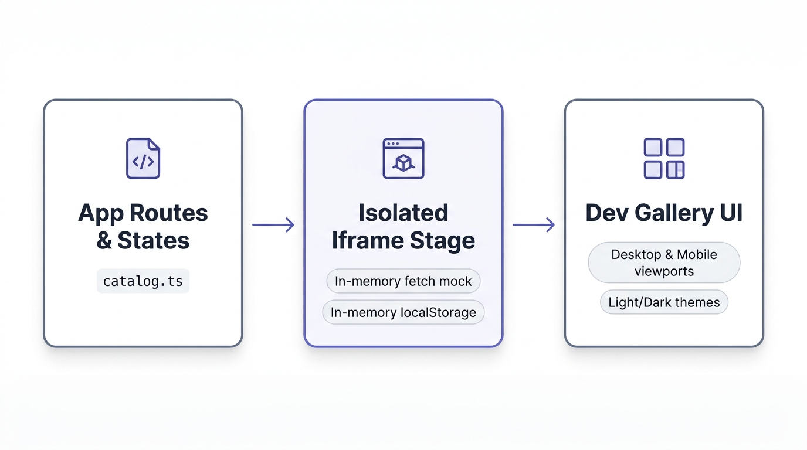

# Screen Gallery

> Zero-config, full-page dev screen gallery for Vite + React apps and AI coding agents.


**Screen Gallery** is a lightweight, dev-only alternative to Storybook built for **full application routes and real user states** (authenticated, empty, loading, error, offline) — without touching your production bundle, starting a backend, or leaking state into your normal dev `localStorage`.

---

## Why Screen Gallery?

- **Full routes, not just isolated buttons:** Mounts your real `<App />` inside an `<iframe>` at any route (`/` , `/login`, `/dashboard`, etc.).
- **True mobile breakpoints:** Toggle between **Desktop** and **Mobile (`372×772`)** inside a real iframe, so CSS media queries behave accurately.
- **Zero backend required:** Intercepts `/api/*` requests in memory using catalog responses (`pending`, `networkError`, HTTP status codes).
- **Clean `localStorage`:** Gives every screen its own in-memory `Storage` instance.
- **Zero production footprint:** Lives in `gallery.html`, completely ignored by `vite build`.
- **Built for AI coding agents:** Ships as a universal `SKILL.md` + Node CLI so **Antigravity, Claude Code, Codex, Cursor, and Gemini CLI** can scaffold and maintain your screens automatically.

---

## Architecture



1. **`src/gallery/catalog.ts`** — Defines groups, screens, routes, mock `/api/*` responses, and interactive `steps`.
2. **`src/gallery/stage.tsx`** — Mounts `<App />` inside the iframe with in-memory `localStorage` and a `fetch` `/api/*` interceptor.
3. **`src/gallery/Gallery.tsx`** — Renders the sidebar, Desktop/Mobile toggle, Light/Dark theme toggle, and preview iframe.

---

## Quick Start (CLI)

From your Vite + React app root (where `index.html` and `vite.config.*` live):

```bash
npx screen-gallery init
```

Or run directly from a local clone:

```bash
node /path/to/screen-gallery/bin/cli.mjs init --dir /path/to/your-web-app
```

Then start Vite and open:

```
http://localhost:5173/gallery.html
```

### Generated Files

```text
your-web-app/
├── gallery.html                 # Dev-only HTML entry (ignored by vite build)
└── src/gallery/
    ├── main.tsx                 # Routes between Gallery shell and isolated Stage
    ├── Gallery.tsx              # Sidebar, viewport & theme toggles, iframe host
    ├── stage.tsx                # In-memory Storage + /api/* mock + step runner
    ├── catalog.ts               # Your screen groups, routes, and states
    └── catalog.test.ts          # Vitest guard (unique IDs, synthetic emails)
```

---

## Using as an AI Agent Skill (All Agents)

This repository follows the universal **`SKILL.md`** standard.

### Antigravity / Gemini CLI / Codex / Cursor
Copy or install this folder into your workspace or global skills directory:

```bash
# Project-level (recommended for teams)
mkdir -p .agents/skills
git clone https://github.com/GuilhermeBotingnon/screen-gallery.git .agents/skills/screen-gallery

# Or via skills CLI (when published)
npx skills add GuilhermeBotingnon/screen-gallery
```

### Claude Code
```bash
mkdir -p ~/.claude/skills
git clone https://github.com/GuilhermeBotingnon/screen-gallery.git ~/.claude/skills/screen-gallery
```

Once installed, simply ask your AI agent:
> *"Set up a screen gallery for this frontend and catalog all routes and states using synthetic data."*

---

## Writing Screens & States (`catalog.ts`)

```ts
{
  name: "Sign in",
  description: "Authentication form.",
  path: "/login",
  states: [
    {
      name: "invalid credentials",
      description: "Shows inline error after failed sign-in.",
      api: {
        "POST /api/login": { status: 401, body: { error: "Invalid credentials" } },
      },
      steps: async (h) => {
        await h.type("Email", "alex.silva@example.test");
        await h.type("Password", "wrong-password");
        await h.click("Sign in");
      },
    },
    {
      name: "loading",
      description: "Keeps the submit request pending.",
      api: {
        "POST /api/login": { pending: true },
      },
      steps: async (h) => {
        await h.type("Email", "alex.silva@example.test");
        await h.type("Password", "demo123");
        await h.click("Sign in");
      },
    },
  ],
}
```

### Available `MockResponse` options
- `status?: number` (default `200`)
- `body?: unknown` (serialized as JSON)
- `pending?: boolean` (never resolves — great for testing spinners/skeletons)
- `networkError?: boolean` (rejects with `TypeError("Failed to fetch")`)

---

## License

MIT © 2026 [Guilherme Botingnon](https://github.com/GuilhermeBotingnon)
